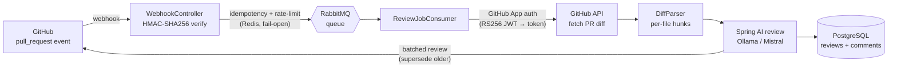

# AI PR Reviewer

An **AI-powered code-review bot for GitHub pull requests**, built with Java 21 and
Spring Boot. It authenticates as a GitHub App, ingests webhook deliveries securely,
runs an LLM over each changed file, and posts a single batched review back to the
PR — with idempotency, rate limiting, and asynchronous processing built in.

[](https://github.com/sevimakpinareng/ai-pr-reviewer/actions/workflows/ci.yml)


## ✨ Highlights

- 🔐 **HMAC-verified webhooks** — every delivery's `X-Hub-Signature-256` is verified
  with **HMAC-SHA256 over the raw request body**, compared in **constant time**
  (timing-attack resistant). Invalid/missing signatures are rejected with `401`.
- 🔑 **GitHub App authentication** — signs a short-lived **RS256 JWT** with the App's
  RSA private key (PKCS#1 or PKCS#8), exchanges it for an installation token, and
  calls the GitHub API as the installation.
- ⚡ **Async processing** — the webhook returns fast; the actual review runs off a
  **RabbitMQ** work queue with retry and dead-lettering, so slow LLM calls never
  block or time out GitHub deliveries.
- 🧠 **Redis-backed guards** — **idempotency/dedup** (the same delivery is never
  reviewed twice), **PR superseding** (a new push cancels the in-flight review of an
  older commit), and **rate limiting** per installation. All guards **fail open**, so
  a Redis outage degrades gracefully instead of dropping reviews.
- 🤖 **Pluggable LLM review** — per-file diff analysis via **Spring AI**, defaulting to
  local **Ollama** (`qwen2.5-coder`) for free development, switchable to the hosted
  **Mistral** API with one profile flag. Findings are severity-ranked and posted as a
  single batched PR review.
- 📊 **Observability** — **Prometheus** metrics (Micrometer) and **structured logging**
  with per-delivery MDC context (delivery id, repo, PR number).
- 🗄️ **Persistent state** — reviews and comments stored in **PostgreSQL** with
  **Flyway** migrations; API documented via **springdoc-openapi** (Swagger UI).
- ✅ **72 tests** — fast unit tests **plus** Testcontainers integration tests against
  real PostgreSQL, Redis, and RabbitMQ, with JaCoCo coverage.

## 🧰 Tech stack

| Concern           | Technology                                             |
| ----------------- | ------------------------------------------------------ |
| Runtime           | Java 21, Spring Boot 3.4                               |
| AI                | Spring AI 1.0 — Ollama (default) / Mistral (profile)   |
| Database          | PostgreSQL 16 + Flyway migrations                      |
| Async queue       | RabbitMQ (Spring AMQP)                                  |
| Guards / cache    | Redis (dedup, superseding, rate limiting)              |
| GitHub            | GitHub App (RS256 JWT auth), webhook (HMAC-SHA256)     |
| API docs          | springdoc-openapi (Swagger UI)                         |
| Observability     | Micrometer + Prometheus, structured logging (Logback)  |
| Testing           | JUnit 5, Testcontainers, JaCoCo                        |
| Tooling / DevOps  | Maven (wrapper), Docker, Docker Compose, GitHub Actions|

## 🏛️ Architecture & flow

A GitHub PR event flows through verification and guard layers before an LLM ever runs,
and heavy work happens off the request thread:



1. **Ingest & verify** — `WebhookController` reads the raw body and verifies the
   `X-Hub-Signature-256` HMAC before doing anything else.
2. **Guard** — Redis-backed idempotency skips duplicate deliveries; a per-installation
   rate limiter requeues when over budget.
3. **Enqueue** — the delivery is handed to RabbitMQ and the endpoint returns `200`
   immediately.
4. **Authenticate** — the consumer mints an RS256 JWT from the App's private key and
   exchanges it for an installation token.
5. **Fetch & parse** — pulls the PR diff and splits it into per-file hunks with
   line mapping.
6. **Review** — Spring AI runs the review prompt per file; findings are collected,
   severity-ranked, and capped.
7. **Publish & persist** — posts one batched review to the PR (superseding any review
   from an older commit) and stores the result in PostgreSQL.

### Standout technical decisions

- **Verify before you trust** — signature verification runs over the *exact* bytes
  GitHub signed (no JSON round-trip) and uses constant-time comparison.
- **Never block the webhook** — LLM latency is unpredictable, so review work is fully
  asynchronous over RabbitMQ; GitHub always gets a fast `200`.
- **Correctness under races** — pushing a new commit *supersedes* the in-flight review
  of the previous one, so stale reviews are never posted.
- **Degrade, don't drop** — Redis guards fail open: if Redis is down, reviews still run
  (just without dedup/rate-limit), rather than being silently lost.

## 🚀 Quick start

**Prerequisites:** [JDK 21](https://adoptium.net/), Docker + Docker Compose, and a
GitHub App (App ID, private key `.pem`, and a webhook secret).

```bash
# 1. Provide local config (gitignored)
cp .env.example .env
#    set GITHUB_APP_ID, GITHUB_WEBHOOK_SECRET, GITHUB_PRIVATE_KEY_PATH,
#    and (optionally) MISTRAL_API_KEY. Put the App private key under ./secrets/.

# 2. Start the infrastructure (PostgreSQL, Redis, RabbitMQ, Prometheus, Grafana)
docker compose up -d

# 3. Run the app (Ollama profile is the default; pull the model first if using it)
#    ollama pull qwen2.5-coder:7b
./mvnw spring-boot:run
```

Flyway applies migrations on startup. To use hosted Mistral instead of local Ollama:

```bash
SPRING_PROFILES_ACTIVE=mistral MISTRAL_API_KEY=... ./mvnw spring-boot:run
```

Point your GitHub App's webhook at `POST /api/webhooks/github` (e.g. via a tunnel in
development).

### Configuration

All secrets come from the environment — **nothing sensitive is committed**. See
[`.env.example`](.env.example) for the full list; the key groups are:

| Group        | Variables (examples)                                             |
| ------------ | --------------------------------------------------------------- |
| Database     | `DB_URL`, `DB_USER`, `DB_PASSWORD`                              |
| RabbitMQ     | `RABBITMQ_HOST`, `RABBITMQ_PORT`, `RABBITMQ_USER`, `RABBITMQ_PASSWORD` |
| Redis        | `REDIS_HOST`, `REDIS_PORT`, `DEDUPE_TTL`, `SUPERSEDE_TTL`, `RATELIMIT_LIMIT`, `RATELIMIT_WINDOW` |
| GitHub       | `GITHUB_WEBHOOK_SECRET`, `GITHUB_APP_ID`, `GITHUB_PRIVATE_KEY_PATH` |
| AI review    | `OLLAMA_BASE_URL`, `OLLAMA_MODEL`, `MISTRAL_API_KEY`, `MISTRAL_MODEL`, `REVIEW_*` tuning |

### Endpoints

| Endpoint                    | Purpose                                |
| --------------------------- | -------------------------------------- |
| `POST /api/webhooks/github` | Signed GitHub webhook ingestion        |
| `GET /api/health`           | Liveness check                         |
| `GET /actuator/health`      | Spring Boot health (includes DB)       |
| `GET /actuator/prometheus`  | Prometheus scrape endpoint             |
| `GET /swagger-ui.html`      | API documentation (springdoc-openapi)  |

## 🧪 Testing

**72 tests** in `src/test` across two tiers:

- **Unit** — HMAC verification, RSA key loading, diff parsing/line mapping, review
  orchestration, the Redis guards' fail-open behavior, and metrics.
- **Integration (Testcontainers)** — the app over real **PostgreSQL**, **Redis**, and
  **RabbitMQ** containers: persistence, the async consumer, actuator endpoints, and a
  full **webhook → queue → review → persist** end-to-end path. External edges (the
  GitHub API and the LLM) are mocked, so **no secrets are needed** to run the suite.

```bash
# Full suite (Docker must be running for Testcontainers) + JaCoCo coverage
./mvnw verify          # report at target/site/jacoco/index.html

# Fast unit tests only (skip the container-backed ones)
./mvnw test -DexcludedGroups=integration
```

> **Testcontainers with Colima:** on standard Docker (Linux/CI) `./mvnw verify` just
> works. If you use Colima instead of Docker Desktop, use the bundled local profile,
> which pins the Docker API version and honors a space-free socket path:
>
> ```bash
> ln -sf "$HOME/Library/Application Support/colima/default/docker.sock" /tmp/colima.sock
> DOCKER_HOST=unix:///tmp/colima.sock ./mvnw -Pcolima verify
> ```

## 🔄 Continuous integration

Every push to `main` and every pull request runs
[`.github/workflows/ci.yml`](.github/workflows/ci.yml): a fast **compile** job for
quick feedback, then a **build** job that runs `mvn verify` (build + unit + integration
+ coverage). Testcontainers runs on the runner's Docker; because the external edges are
mocked, **no secrets are required**. Surefire and JaCoCo reports are uploaded as
artifacts, and [Dependabot](.github/dependabot.yml) opens weekly dependency PRs.

## 🗺️ Roadmap

- [x] Secure webhook ingestion (HMAC-SHA256)
- [x] GitHub App authentication (RS256 JWT) + PR diff fetch
- [x] LLM diff review via Spring AI (Ollama / Mistral)
- [x] Persistence (PostgreSQL + Flyway) and batched PR review publishing
- [x] Async processing (RabbitMQ)
- [x] Redis guards: idempotency, superseding, rate limiting
- [x] Observability (Prometheus metrics, structured logging) + coverage
- [ ] Inline (line-level) review comments
- [ ] Configurable per-repo review policies
